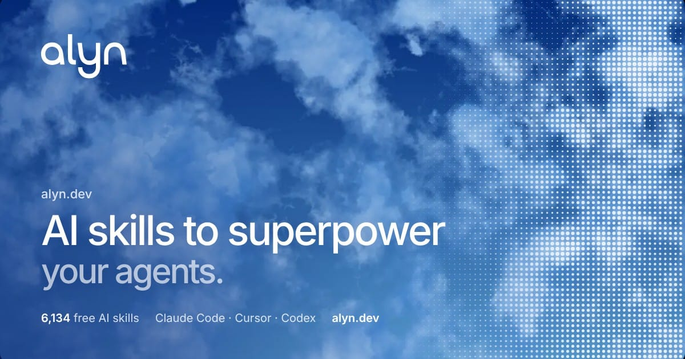

<p align="center">
  <a href="https://alyn.dev"></a>
</p>

<h1 align="center">Alyn</h1>

<p align="center"><b>The right skill for every task, in every agent.</b></p>

<p align="center">
  <a href="https://www.npmjs.com/package/alyn-cli"></a>
  <a href="https://github.com/tammo1007/alyn/actions/workflows/ci.yml"></a>
  <a href="mcp/README.md"></a>
  <a href="LICENSE"></a>
</p>

<p align="center">
  <a href="https://alyn.dev">Website</a> ·
  <a href="#connect-alyn-mcp">Connect</a> ·
  <a href="#alyn-cli">CLI</a> ·
  <a href="#alyn-skills">Skills</a> ·
  <a href="#top-10-ai-skills-this-week">This week</a>
</p>

<br>

There are thousands of agent skills on GitHub, and most agents never use the right one. **Alyn fixes that.** Connect it once to Claude Code, Cursor, Codex or any MCP client. For every task, your agent asks Alyn which skill fits, loads it and follows it. No browsing, no copying folders around.

Alyn knows **6,134 open source skills** by **445 creators** and ranks them by GitHub stars, real installs and the quality of each SKILL.md. The data refreshes every night, and this README every Monday.

## Why skills matter

> **A small model with the right skill beats a big model without one.**
> On [SkillsBench](https://arxiv.org/abs/2602.12670), Claude Haiku 4.5 with skills solved 27.7% of tasks. Claude Opus 4.5 without skills solved 22.0%. Given skills, Opus itself jumped to 45.3%. Curated skills added 16.2 points on average.

So the skill matters as much as the model. Alyn makes sure your agent has the best one for the job, and lets you run cheaper models for more of your work.

## Connect Alyn MCP

One remote MCP server, no account, no API key.

```bash
claude mcp add --transport http alyn-mcp https://alyn.dev/mcp
```

| Agent | How |
| --- | --- |
| Claude Code | The command above |
| Claude (web, desktop, mobile) | Settings › Connectors › Add custom connector › `https://alyn.dev/mcp` |
| Cursor | Add `"alyn-mcp": { "url": "https://alyn.dev/mcp" }` to `~/.cursor/mcp.json` |
| Codex | `codex mcp add alyn-mcp --url https://alyn.dev/mcp` |
| VS Code, Windsurf, any MCP client | [Setup for every client](mcp/README.md) |

Then just work as usual:

> *Make this pricing page look less AI-generated.*

<p align="center"><code>your task</code> → <code>find_skills</code> → <code>best skill</code> → <code>load_skill</code> → <b>done</b></p>

The agent calls `find_skills`, picks the best match and loads it for the current session. To keep a skill for good, it calls `install_skill`. [All tools →](mcp/README.md#tools)

## Alyn CLI

Install skills, bundles or whole packs into any agent in one line.

```bash
npx alyn-cli find "write a PRD"      # the best skills for a task
npx alyn-cli add unslop              # one skill
npx alyn-cli add bundle:design       # a complete setup
npx alyn-cli add obra/superpowers    # every skill in a pack
```

Detects Claude Code, Cursor, Codex and 70+ other agents. [CLI docs →](cli/README.md)

## Alyn skills

Three skills that make any agent better at using skills.

| Skill | What it does |
| --- | --- |
| [**find-skill**](skills/find-skill/SKILL.md) | Before improvising, the agent asks Alyn for the best existing skill for the task. |
| [**skill-check**](skills/skill-check/SKILL.md) | Reviews a SKILL.md against the six quality checks of the [Alyn Score](https://alyn.dev/alyn-score) and fixes it. Ships a checker script. |
| [**alyn-setup**](skills/alyn-setup/SKILL.md) | Sets up a complete skill stack for your kind of work with one of the bundles below. |

```bash
npx skills add tammo1007/alyn
```

## Bundles

Complete setups for one kind of work, curated by Alyn.

| Bundle | For | Skills | Install |
| --- | --- | :-: | --- |
| [**Design setup**](https://alyn.dev/bundles/design) | Taste, polish and zero AI slop for every UI your agent builds. | 6 | `npx alyn-cli add bundle:design` |
| [**Engineering workflow**](https://alyn.dev/bundles/engineering) | Brainstorm, plan, test first, debug systematically, review, ship. | 8 | `npx alyn-cli add bundle:engineering` |
| [**Startup founder setup**](https://alyn.dev/bundles/founder) | From idea to PRD to launch, with an opinionated CEO review in between. | 8 | `npx alyn-cli add bundle:founder` |
| [**Human writing**](https://alyn.dev/bundles/writer) | Text that does not read like a chatbot wrote it. | 5 | `npx alyn-cli add bundle:writer` |
| [**SEO and GEO**](https://alyn.dev/bundles/seo-geo) | Rank on Google and get cited by ChatGPT and Perplexity. | 7 | `npx alyn-cli add bundle:seo-geo` |
| [**Marketing team**](https://alyn.dev/bundles/marketing) | CRO, copy, launches, emails and ads, from the most installed marketing pack. | 8 | `npx alyn-cli add bundle:marketing` |
| [**Office documents**](https://alyn.dev/bundles/documents) | Real PDF, Word, Excel and PowerPoint files from your agent. | 5 | `npx alyn-cli add bundle:documents` |
| [**Video studio**](https://alyn.dev/bundles/video) | Launch videos, explainers and captions, as editable Remotion code. | 5 | `npx alyn-cli add bundle:video` |
| [**Token saver**](https://alyn.dev/bundles/lean) | Shorter answers, fewer tokens, less over-engineering. | 5 | `npx alyn-cli add bundle:lean` |

## Top 10 AI skills this week

<sub>Week of November 9, 2026. Ranked by new GitHub stars, installs through Alyn and the Alyn Score, one skill per pack. [Live ranking →](https://alyn.dev/top-10-ai-skills-this-week)</sub>

| # | Skill | By | Stars | Install |
| :-: | --- | --- | --- | --- |
| 1 | [**Agent Harness Construction**](https://alyn.dev/skills/agent-harness-construction)<br><sub>Design and optimize AI agent action spaces, tool definitions, and observation formatting…</sub> | affaan-m<br><sub>ECC</sub> | ★ 301k<br><sub>1k/day</sub> | `npx alyn-cli add agent-harness-construction` |
| 2 | [**Reverse Skill Router**](https://alyn.dev/skills/reverse-skill-router)<br><sub>Routes reverse engineering, exploitation, penetration testing, malware, mobile, firmware,…</sub> | zhaoxuya520<br><sub>Reverse Skill</sub> | ★ 44.5k<br><sub>244/day</sub> | `npx alyn-cli add reverse-skill-router` |
| 3 | [**Code Review**](https://alyn.dev/skills/code-review)<br><sub>Review the changes since a fixed point (commit, branch, tag, or merge-base) along two…</sub> | Matt Pocock<br><sub>Matt Pocock</sub> | ★ 321k<br><sub>1.1k/day</sub> | `npx alyn-cli add code-review` |
| 4 | [**Analyzing iOS App Security With Objection**](https://alyn.dev/skills/analyzing-ios-app-security-with-objection)<br><sub>Runtime iOS app security testing with Objection (Frida): inspect keychain and filesystem…</sub> | mukul975<br><sub>Anthropic Cybersecurity</sub> | ★ 35.9k<br><sub>138/day</sub> | `npx alyn-cli add analyzing-ios-app-security-with-objection` |
| 5 | [**Acreadiness Generate Instructions**](https://alyn.dev/skills/acreadiness-generate-instructions)<br><sub>Generate tailored AI agent instruction files via AgentRC instructions command. Produces…</sub> | GitHub<br><sub>Awesome Copilot</sub> | ★ 41k<br><sub>79/day</sub> | `npx alyn-cli add acreadiness-generate-instructions` |
| 6 | [**Accounting Software Selection**](https://alyn.dev/skills/accounting-software-selection)<br><sub>Scores shortlisted accounting packages against 57 evidence-backed fields, emitted as CSV,…</sub> | sickn33<br><sub>Agentic Awesome</sub> | ★ 49.5k<br><sub>165/day</sub> | `npx alyn-cli add accounting-software-selection` |
| 7 | [**Analytics**](https://alyn.dev/skills/analytics)<br><sub>When the user wants to set up or audit analytics, or asks whether a metric or number is…</sub> | Corey Haines<br><sub>Marketingskills</sub> | ★ 59.7k<br><sub>199/day</sub> | `npx alyn-cli add analytics` |
| 8 | [**Baoyu Comic**](https://alyn.dev/skills/baoyu-comic)<br><sub>Knowledge comic creator supporting multiple art styles and tones. Creates original…</sub> | JimLiu<br><sub>Baoyu</sub> | ★ 27.5k<br><sub>91/day</sub> | `npx alyn-cli add baoyu-comic` |
| 9 | [**Aeon**](https://alyn.dev/skills/aeon)<br><sub>This skill should be used for time series machine learning tasks including…</sub> | K-Dense<br><sub>Scientific</sub> | ★ 56.8k<br><sub>146/day</sub> | `npx alyn-cli add aeon` |
| 10 | [**Create Video**](https://alyn.dev/skills/create-video)<br><sub>Create videos from a text prompt using HeyGen's Video Agent. Use when: (1) Creating a…</sub> | OpenMontage<br><sub>OpenMontage</sub> | ★ 79.6k<br><sub>350/day</sub> | `npx alyn-cli add create-video` |

## Best AI skills by category

<sub>The three highest-scoring skills in every category. Click to open.</sub>

<details>
<summary><b>Anti-slop</b> · Impeccable, Anti UI Slop, Avoid AI Writing</summary>
<br>

| Skill | What it does | By | Stars | Install |
| --- | --- | --- | --- | --- |
| [**Impeccable**](https://alyn.dev/skills/impeccable) | Use to design, redesign, critique, audit, polish or animate a frontend: websites, landing pages,… | Paul Bakaus | ★ 108k | `npx alyn-cli add impeccable` |
| [**Anti UI Slop**](https://alyn.dev/skills/anti-ui-slop) | Stop coding agents from shipping generic UI. Use UIZZE's 800,000+ real web and iOS screens to build… | GitHub | ★ 41k | `npx alyn-cli add anti-ui-slop` |
| [**Avoid AI Writing**](https://alyn.dev/skills/avoid-ai-writing) | Audit and rewrite prose so it stops reading as machine-generated. Use this skill when asked to… | wshobson | ★ 42.4k | `npx alyn-cli add avoid-ai-writing` |

[All anti-slop skills on Alyn →](https://alyn.dev/best-claude-skills/anti-slop)

</details>
<details>
<summary><b>Design</b> · Prototype, Brand Discovery, Accessibility</summary>
<br>

| Skill | What it does | By | Stars | Install |
| --- | --- | --- | --- | --- |
| [**Prototype**](https://alyn.dev/skills/prototype) | Build a throwaway prototype to answer a design question. Use when the user wants to sanity-check… | Matt Pocock | ★ 321k | `npx alyn-cli add prototype` |
| [**Brand Discovery**](https://alyn.dev/skills/brand-discovery) | Run a structured, resumable multi-session brand identity interview across 8 modules (purpose,… | affaan-m | ★ 301k | `npx alyn-cli add brand-discovery` |
| [**Accessibility**](https://alyn.dev/skills/accessibility) | Design, implement, and audit accessible UI to WCAG 2.2 Level AA across Web, iOS, and Android,… | affaan-m | ★ 301k | `npx alyn-cli add accessibility` |

[All design skills on Alyn →](https://alyn.dev/best-claude-skills/design)

</details>
<details>
<summary><b>Frontend</b> · Angular Developer, Backend Patterns, Design System</summary>
<br>

| Skill | What it does | By | Stars | Install |
| --- | --- | --- | --- | --- |
| [**Angular Developer**](https://alyn.dev/skills/angular-developer) | Generates Angular code and provides architectural guidance. Trigger when creating projects,… | affaan-m | ★ 301k | `npx alyn-cli add angular-developer` |
| [**Backend Patterns**](https://alyn.dev/skills/backend-patterns) | Backend architecture patterns, API design, database optimization, and server-side best practices… | affaan-m | ★ 301k | `npx alyn-cli add backend-patterns` |
| [**Design System**](https://alyn.dev/skills/design-system) | Token architecture, component specifications, and slide generation. Three-layer tokens… | nextlevelbuilder | ★ 148k | `npx alyn-cli add design-system` |

[All frontend skills on Alyn →](https://alyn.dev/best-claude-skills/frontend)

</details>
<details>
<summary><b>Web development</b> · Brand Landingpage, Vercel Composition Patterns, Vercel React Best Practices</summary>
<br>

| Skill | What it does | By | Stars | Install |
| --- | --- | --- | --- | --- |
| [**Brand Landingpage**](https://alyn.dev/skills/brand-landingpage) | Brand-first landing page designer, runs a brand-identity interview (colors, typography, shape… | wshobson | ★ 42.4k | `npx alyn-cli add brand-landingpage` |
| [**Vercel Composition Patterns**](https://alyn.dev/skills/vercel-composition-patterns) | React composition patterns that scale. Use when refactoring components with boolean prop… | Vercel | ★ 33.9k | `npx alyn-cli add vercel-composition-patterns` |
| [**Vercel React Best Practices**](https://alyn.dev/skills/vercel-react-best-practices) | React and Next.js performance optimization guidelines from Vercel Engineering. This skill should be… | Vercel | ★ 33.9k | `npx alyn-cli add vercel-react-best-practices` |

[All web development skills on Alyn →](https://alyn.dev/best-claude-skills/web-development)

</details>
<details>
<summary><b>Backend</b> · MCP Builder, API And Interface Design, API Design Principles</summary>
<br>

| Skill | What it does | By | Stars | Install |
| --- | --- | --- | --- | --- |
| [**MCP Builder**](https://alyn.dev/skills/mcp-builder) | Guide for creating high-quality MCP (Model Context Protocol) servers that enable LLMs to interact… | Anthropic | ★ 193k | `npx alyn-cli add mcp-builder` |
| [**API And Interface Design**](https://alyn.dev/skills/api-and-interface-design) | Guides stable API and interface design. Use when designing APIs, module boundaries, or any public… | Addy Osmani | ★ 116k | `npx alyn-cli add api-and-interface-design` |
| [**API Design Principles**](https://alyn.dev/skills/api-design-principles) | Master REST and GraphQL API design principles to build intuitive, scalable, and maintainable APIs… | wshobson | ★ 42.4k | `npx alyn-cli add api-design-principles` |

[All backend skills on Alyn →](https://alyn.dev/best-claude-skills/backend)

</details>
<details>
<summary><b>Coding</b> · Codebase Design, Diagnosing Bugs, Caveman</summary>
<br>

| Skill | What it does | By | Stars | Install |
| --- | --- | --- | --- | --- |
| [**Codebase Design**](https://alyn.dev/skills/codebase-design) | Shared vocabulary for designing deep modules. Use when the user wants to design or improve a… | Matt Pocock | ★ 321k | `npx alyn-cli add codebase-design` |
| [**Diagnosing Bugs**](https://alyn.dev/skills/diagnosing-bugs) | Diagnosis loop for hard bugs and performance regressions. Use when the user says "diagnose"/"debug… | Matt Pocock | ★ 321k | `npx alyn-cli add diagnosing-bugs` |
| [**Caveman**](https://alyn.dev/skills/caveman) | Terse caveman voice: answer first, fluff gone, every technical fact kept. Use for /caveman,… | JuliusBrussee | ★ 119k | `npx alyn-cli add caveman` |

[All coding skills on Alyn →](https://alyn.dev/best-claude-skills/coding)

</details>
<details>
<summary><b>Code review</b> · Setup Pre Commit, Caveman Review, Requesting Code Review</summary>
<br>

| Skill | What it does | By | Stars | Install |
| --- | --- | --- | --- | --- |
| [**Setup Pre Commit**](https://alyn.dev/skills/setup-pre-commit) | Set up Husky pre-commit hooks with lint-staged (Prettier), type checking, and tests in the current… | Matt Pocock | ★ 321k | `npx alyn-cli add setup-pre-commit` |
| [**Caveman Review**](https://alyn.dev/skills/caveman-review) | Compressed code review - one line per finding with location, problem and fix. Use for… | JuliusBrussee | ★ 119k | `npx alyn-cli add caveman-review` |
| [**Requesting Code Review**](https://alyn.dev/skills/requesting-code-review) | Use when completing tasks, implementing major features, or before merging to verify work meets… | Jesse Vincent | ★ 316k | `npx alyn-cli add requesting-code-review` |

[All code review skills on Alyn →](https://alyn.dev/best-claude-skills/code-review)

</details>
<details>
<summary><b>Testing</b> · Migrate To Shoehorn, TDD, Rea Analysis Optimization</summary>
<br>

| Skill | What it does | By | Stars | Install |
| --- | --- | --- | --- | --- |
| [**Migrate To Shoehorn**](https://alyn.dev/skills/migrate-to-shoehorn) | Migrate test files from `as` type assertions to @total-typescript/shoehorn. Use when user mentions… | Matt Pocock | ★ 321k | `npx alyn-cli add migrate-to-shoehorn` |
| [**TDD**](https://alyn.dev/skills/tdd) | Test-driven development. Use when the user wants to build features or fix bugs test-first, mentions… | Matt Pocock | ★ 321k | `npx alyn-cli add tdd` |
| [**Rea Analysis Optimization**](https://alyn.dev/skills/rea-analysis-optimization) | Optimize REA providers and shared analysis workflows for agent context, latency, CPU, and memory… | morluto | ★ 451k | `npx alyn-cli add rea-analysis-optimization` |

[All testing skills on Alyn →](https://alyn.dev/best-claude-skills/testing)

</details>
<details>
<summary><b>DevOps</b> · Launch, Arize AI Provider Integration, Arize Evaluator</summary>
<br>

| Skill | What it does | By | Stars | Install |
| --- | --- | --- | --- | --- |
| [**Launch**](https://alyn.dev/skills/launch) | When the user wants to plan a product or feature launch, or asks whether it's ready, when to… | Corey Haines | ★ 59.7k | `npx alyn-cli add launch` |
| [**Arize AI Provider Integration**](https://alyn.dev/skills/arize-ai-provider-integration) | Creates, reads, updates, and deletes Arize AI integrations that store LLM provider credentials used… | GitHub | ★ 41k | `npx alyn-cli add arize-ai-provider-integration` |
| [**Arize Evaluator**](https://alyn.dev/skills/arize-evaluator) | Handles LLM-as-judge evaluation workflows on Arize including creating/updating evaluators, running… | GitHub | ★ 41k | `npx alyn-cli add arize-evaluator` |

[All devops skills on Alyn →](https://alyn.dev/best-claude-skills/devops)

</details>
<details>
<summary><b>Security</b> · Rea CI Tests Audit, Agent Security Hardening, Security And Hardening</summary>
<br>

| Skill | What it does | By | Stars | Install |
| --- | --- | --- | --- | --- |
| [**Rea CI Tests Audit**](https://alyn.dev/skills/rea-ci-tests-audit) | Audit REA CI and test suites for correctness, fixture drift, false passes, and measured… | morluto | ★ 451k | `npx alyn-cli add rea-ci-tests-audit` |
| [**Agent Security Hardening**](https://alyn.dev/skills/agent-security-hardening) | Security hardening guidance for AI agent frameworks that process untrusted content, invoke tools,… | affaan-m | ★ 301k | `npx alyn-cli add agent-security-hardening` |
| [**Security And Hardening**](https://alyn.dev/skills/security-and-hardening) | Hardens code against vulnerabilities. Use when auditing an input handler for vulnerabilities, when… | Addy Osmani | ★ 116k | `npx alyn-cli add security-and-hardening` |

[All security skills on Alyn →](https://alyn.dev/best-claude-skills/security)

</details>
<details>
<summary><b>Data analysis</b> · Ab Testing, Attribution, D3 Viz</summary>
<br>

| Skill | What it does | By | Stars | Install |
| --- | --- | --- | --- | --- |
| [**Ab Testing**](https://alyn.dev/skills/ab-testing) | When the user wants to plan, run, or read A/B tests, or asks a judgement call on one: is the result… | Corey Haines | ★ 59.7k | `npx alyn-cli add ab-testing` |
| [**Attribution**](https://alyn.dev/skills/attribution) | When the user wants to work out which marketing drives revenue, or asks whether a channel is really… | Corey Haines | ★ 59.7k | `npx alyn-cli add attribution` |
| [**D3 Viz**](https://alyn.dev/skills/d3-viz) | Creating interactive data visualisations using d3.js. This skill should be used when creating… | OpenMontage | ★ 79.6k | `npx alyn-cli add d3-viz` |

[All data analysis skills on Alyn →](https://alyn.dev/best-claude-skills/data-analysis)

</details>
<details>
<summary><b>Documents</b> · Canvas Design, Docx, PDF</summary>
<br>

| Skill | What it does | By | Stars | Install |
| --- | --- | --- | --- | --- |
| [**Canvas Design**](https://alyn.dev/skills/canvas-design) | Create beautiful visual art in .png and .pdf documents using design philosophy. You should use this… | Anthropic | ★ 193k | `npx alyn-cli add canvas-design` |
| [**Docx**](https://alyn.dev/skills/docx) | Use this skill whenever the user wants to create, read, edit, or manipulate Word documents (.docx… | Anthropic | ★ 193k | `npx alyn-cli add docx` |
| [**PDF**](https://alyn.dev/skills/pdf) | Use this skill whenever the user wants to do anything with PDF files. This includes reading or… | Anthropic | ★ 193k | `npx alyn-cli add pdf` |

[All documents skills on Alyn →](https://alyn.dev/best-claude-skills/documents)

</details>
<details>
<summary><b>Presentations</b> · Nature Image2ppt, Nature Paper2ppt, Baoyu Slide Deck</summary>
<br>

| Skill | What it does | By | Stars | Install |
| --- | --- | --- | --- | --- |
| [**Nature Image2ppt**](https://alyn.dev/skills/nature-image2ppt) | Reconstruct slide images, screenshots, scanned PDFs, or image-only PPTX files as object-level… | Yuan1z0825 | ★ 53.2k | `npx alyn-cli add nature-image2ppt` |
| [**Nature Paper2ppt**](https://alyn.dev/skills/nature-paper2ppt) | Create or improve a Chinese academic PPTX from a scientific paper or research reading notes, with… | Yuan1z0825 | ★ 53.2k | `npx alyn-cli add nature-paper2ppt` |
| [**Baoyu Slide Deck**](https://alyn.dev/skills/baoyu-slide-deck) | Generates professional slide deck images from content. Creates outlines with style instructions,… | JimLiu | ★ 27.5k | `npx alyn-cli add baoyu-slide-deck` |

[All presentations skills on Alyn →](https://alyn.dev/best-claude-skills/presentations)

</details>
<details>
<summary><b>Writing</b> · Domain Modeling, Writing For Agents, Caveman Commit</summary>
<br>

| Skill | What it does | By | Stars | Install |
| --- | --- | --- | --- | --- |
| [**Domain Modeling**](https://alyn.dev/skills/domain-modeling) | Build and sharpen a project's domain model. Use when discussing codebase terminology, writing or… | Matt Pocock | ★ 321k | `npx alyn-cli add domain-modeling` |
| [**Writing For Agents**](https://alyn.dev/skills/writing-for-agents) | Writing documents for agents. Use when creating or editing skills, or modifying AGENTS.md or… | Matt Pocock | ★ 321k | `npx alyn-cli add writing-for-agents` |
| [**Caveman Commit**](https://alyn.dev/skills/caveman-commit) | Write a Conventional Commits message compressed to intent only. Use for "write a commit", "commit… | JuliusBrussee | ★ 119k | `npx alyn-cli add caveman-commit` |

[All writing skills on Alyn →](https://alyn.dev/best-claude-skills/writing)

</details>
<details>
<summary><b>Marketing</b> · Benchmark Methodology, Brand Guidelines, Ad Creative</summary>
<br>

| Skill | What it does | By | Stars | Install |
| --- | --- | --- | --- | --- |
| [**Benchmark Methodology**](https://alyn.dev/skills/benchmark-methodology) | Score a scoped competitor set into comparable profile cards: nine weighted dimensions (positioning,… | affaan-m | ★ 301k | `npx alyn-cli add benchmark-methodology` |
| [**Brand Guidelines**](https://alyn.dev/skills/brand-guidelines) | Applies Anthropic's official brand colors and typography to any sort of artifact that may benefit… | Anthropic | ★ 193k | `npx alyn-cli add brand-guidelines` |
| [**Ad Creative**](https://alyn.dev/skills/ad-creative) | When the user wants to write or judge ad creative, or asks which ad, hook, or angle to run or kill:… | Corey Haines | ★ 59.7k | `npx alyn-cli add ad-creative` |

[All marketing skills on Alyn →](https://alyn.dev/best-claude-skills/marketing)

</details>
<details>
<summary><b>SEO & GEO</b> · AI SEO, ASO, Competitor Profiling</summary>
<br>

| Skill | What it does | By | Stars | Install |
| --- | --- | --- | --- | --- |
| [**AI SEO**](https://alyn.dev/skills/ai-seo) | When the user wants to get cited and recommended in AI answers (ChatGPT, Perplexity, AI Overviews),… | Corey Haines | ★ 59.7k | `npx alyn-cli add ai-seo` |
| [**ASO**](https://alyn.dev/skills/aso) | When the user wants to audit or optimize an App Store or Google Play listing, or asks which title,… | Corey Haines | ★ 59.7k | `npx alyn-cli add aso` |
| [**Competitor Profiling**](https://alyn.dev/skills/competitor-profiling) | When the user wants to research competitors into dated profiles, or asks what a rival charges,… | Corey Haines | ★ 59.7k | `npx alyn-cli add competitor-profiling` |

[All seo & geo skills on Alyn →](https://alyn.dev/best-claude-skills/seo)

</details>
<details>
<summary><b>Sales</b> · Cold Email, Free Tools, GTM Motions</summary>
<br>

| Skill | What it does | By | Stars | Install |
| --- | --- | --- | --- | --- |
| [**Cold Email**](https://alyn.dev/skills/cold-email) | When the user wants to write or run B2B cold outbound, or asks whether an opener, reason to reach… | Corey Haines | ★ 59.7k | `npx alyn-cli add cold-email` |
| [**Free Tools**](https://alyn.dev/skills/free-tools) | When the user wants to plan or build a free tool as marketing, or asks whether a tool idea is worth… | Corey Haines | ★ 59.7k | `npx alyn-cli add free-tools` |
| [**GTM Motions**](https://alyn.dev/skills/gtm-motions) | Identify the best GTM motions and tools across 7 motion types: Inbound, Outbound, Paid Digital,… | phuryn | ★ 27.9k | `npx alyn-cli add gtm-motions` |

[All sales skills on Alyn →](https://alyn.dev/best-claude-skills/sales)

</details>
<details>
<summary><b>Product management</b> · Spec Driven Development, SEO SXO, Agent Architecture</summary>
<br>

| Skill | What it does | By | Stars | Install |
| --- | --- | --- | --- | --- |
| [**Spec Driven Development**](https://alyn.dev/skills/spec-driven-development) | Creates specs before coding. Use when starting a new project, feature, or significant change and no… | Addy Osmani | ★ 116k | `npx alyn-cli add spec-driven-development` |
| [**SEO SXO**](https://alyn.dev/skills/seo-sxo) | Diagnose search-experience and intent mismatches using SERP page types, user stories, and persona… | AgriciDaniel | ★ 28k | `npx alyn-cli add seo-sxo` |
| [**Agent Architecture**](https://alyn.dev/skills/agent-architecture) | Design AI agent architectures through requirements discovery, or audit and diagnose architectural… | GitHub | ★ 41k | `npx alyn-cli add agent-architecture` |

[All product management skills on Alyn →](https://alyn.dev/best-claude-skills/product-management)

</details>
<details>
<summary><b>Research</b> · Research, Customer Research, Prospecting</summary>
<br>

| Skill | What it does | By | Stars | Install |
| --- | --- | --- | --- | --- |
| [**Research**](https://alyn.dev/skills/research) | Investigate a question against high-trust primary sources and capture the findings as a Markdown… | Matt Pocock | ★ 321k | `npx alyn-cli add research` |
| [**Customer Research**](https://alyn.dev/skills/customer-research) | When the user wants to run or synthesize customer research, or asks what customer quotes, reviews,… | Corey Haines | ★ 59.7k | `npx alyn-cli add customer-research` |
| [**Prospecting**](https://alyn.dev/skills/prospecting) | When the user wants to find and qualify prospects for outbound, or asks who to target first, which… | Corey Haines | ★ 59.7k | `npx alyn-cli add prospecting` |

[All research skills on Alyn →](https://alyn.dev/best-claude-skills/research)

</details>
<details>
<summary><b>Science</b> · Caveman Manage, Ab Testing, Analytical Method Validation</summary>
<br>

| Skill | What it does | By | Stars | Install |
| --- | --- | --- | --- | --- |
| [**Caveman Manage**](https://alyn.dev/skills/caveman-manage) | Inspect Caveman Cloud's experiment lifecycle and block unsafe execution. Use when asked to start,… | JuliusBrussee | ★ 119k | `npx alyn-cli add caveman-manage` |
| [**Ab Testing**](https://alyn.dev/skills/ab-testing-by-sickn33) | When the user wants to plan, design, or implement an A/B test or experiment, or build a growth… | sickn33 | ★ 49.5k | `npx alyn-cli add ab-testing-by-sickn33` |
| [**Analytical Method Validation**](https://alyn.dev/skills/analytical-method-validation) | Plans, executes, and documents validation, verification, and transfer of analytical procedures… | K-Dense | ★ 56.8k | `npx alyn-cli add analytical-method-validation` |

[All science skills on Alyn →](https://alyn.dev/best-claude-skills/science)

</details>
<details>
<summary><b>Healthcare</b> · Clinical Decision Support, Clinical Reports, Clinical Trials Database</summary>
<br>

| Skill | What it does | By | Stars | Install |
| --- | --- | --- | --- | --- |
| [**Clinical Decision Support**](https://alyn.dev/skills/clinical-decision-support) | Prepares and validates research-only clinical decision-support evaluation, evidence-profile,… | K-Dense | ★ 56.8k | `npx alyn-cli add clinical-decision-support` |
| [**Clinical Reports**](https://alyn.dev/skills/clinical-reports) | Creates safety-bounded draft structures and runs local deterministic checks for clinical case,… | K-Dense | ★ 56.8k | `npx alyn-cli add clinical-reports` |
| [**Clinical Trials Database**](https://alyn.dev/skills/clinical-trials-database) | Query ClinicalTrials.gov via APIv2. Use when you want to search for trials by condition, drug,… | Google DeepMind | ★ 3.5k | `npx alyn-cli add clinical-trials-database` |

[All healthcare skills on Alyn →](https://alyn.dev/best-claude-skills/healthcare)

</details>
<details>
<summary><b>AI engineering</b> · Subagent Driven Development, Agent Architecture Audit, Agent Eval</summary>
<br>

| Skill | What it does | By | Stars | Install |
| --- | --- | --- | --- | --- |
| [**Subagent Driven Development**](https://alyn.dev/skills/subagent-driven-development) | Use when executing implementation plans with independent tasks in the current session | Jesse Vincent | ★ 316k | `npx alyn-cli add subagent-driven-development` |
| [**Agent Architecture Audit**](https://alyn.dev/skills/agent-architecture-audit) | Full-stack diagnostic for agent and LLM applications. Audits the 12-layer agent stack for wrapper… | affaan-m | ★ 301k | `npx alyn-cli add agent-architecture-audit` |
| [**Agent Eval**](https://alyn.dev/skills/agent-eval) | Head-to-head comparison of coding agents (Claude Code, Aider, Codex, etc.) on custom tasks with… | affaan-m | ★ 301k | `npx alyn-cli add agent-eval` |

[All ai engineering skills on Alyn →](https://alyn.dev/best-claude-skills/ai-engineering)

</details>
<details>
<summary><b>MCP</b> · Directory Submissions, Browser Testing With Devtools, Chatgpt App Builder</summary>
<br>

| Skill | What it does | By | Stars | Install |
| --- | --- | --- | --- | --- |
| [**Directory Submissions**](https://alyn.dev/skills/directory-submissions) | When the user wants to list a product in startup, SaaS, AI, MCP, and review directories, or asks… | Corey Haines | ★ 59.7k | `npx alyn-cli add directory-submissions` |
| [**Browser Testing With Devtools**](https://alyn.dev/skills/browser-testing-with-devtools) | Tests in real browsers via Chrome DevTools MCP. Use when building or debugging anything that runs… | Addy Osmani | ★ 116k | `npx alyn-cli add browser-testing-with-devtools` |
| [**Chatgpt App Builder**](https://alyn.dev/skills/chatgpt-app-builder) | DEPRECATED: This skill has been replaced by `mcp-app-builder`. Check if `mcp-app-builder` is… | Shubhamsaboo | ★ 144k | `npx alyn-cli add chatgpt-app-builder` |

[All mcp skills on Alyn →](https://alyn.dev/best-claude-skills/mcp)

</details>
<details>
<summary><b>Automation</b> · AI Regression Testing, API Connector Builder, Automation Audit Ops</summary>
<br>

| Skill | What it does | By | Stars | Install |
| --- | --- | --- | --- | --- |
| [**AI Regression Testing**](https://alyn.dev/skills/ai-regression-testing) | Regression testing strategies for AI-assisted development. Sandbox-mode API testing without… | affaan-m | ★ 301k | `npx alyn-cli add ai-regression-testing` |
| [**API Connector Builder**](https://alyn.dev/skills/api-connector-builder) | Build a new API connector or provider by matching the target repo's existing integration pattern… | affaan-m | ★ 301k | `npx alyn-cli add api-connector-builder` |
| [**Automation Audit Ops**](https://alyn.dev/skills/automation-audit-ops) | Evidence-first automation inventory and overlap audit workflow for ECC. Use when the user wants to… | affaan-m | ★ 301k | `npx alyn-cli add automation-audit-ops` |

[All automation skills on Alyn →](https://alyn.dev/best-claude-skills/automation)

</details>
<details>
<summary><b>Video</b> · Slack Gif Creator, Video, Agents</summary>
<br>

| Skill | What it does | By | Stars | Install |
| --- | --- | --- | --- | --- |
| [**Slack Gif Creator**](https://alyn.dev/skills/slack-gif-creator) | Knowledge and utilities for creating animated GIFs optimized for Slack. Provides constraints,… | Anthropic | ★ 193k | `npx alyn-cli add slack-gif-creator` |
| [**Video**](https://alyn.dev/skills/video) | When the user wants to create video with AI tools or code, or asks which approach to use (screen… | Corey Haines | ★ 59.7k | `npx alyn-cli add video` |
| [**Agents**](https://alyn.dev/skills/agents) | Build voice AI agents with ElevenLabs. Use when creating voice assistants, customer service bots,… | OpenMontage | ★ 79.6k | `npx alyn-cli add agents` |

[All video skills on Alyn →](https://alyn.dev/best-claude-skills/video)

</details>
<details>
<summary><b>Images & art</b> · Algorithmic Art, Archify, Archify Tuning</summary>
<br>

| Skill | What it does | By | Stars | Install |
| --- | --- | --- | --- | --- |
| [**Algorithmic Art**](https://alyn.dev/skills/algorithmic-art) | Creating algorithmic art using p5.js with seeded randomness and interactive parameter exploration.… | Anthropic | ★ 193k | `npx alyn-cli add algorithmic-art` |
| [**Archify**](https://alyn.dev/skills/archify) | Create validated architecture, workflow, sequence, data-flow, lifecycle/state, ERD, class, tree,… | tt-a1i | ★ 95.5k | `npx alyn-cli add archify` |
| [**Archify Tuning**](https://alyn.dev/skills/archify-tuning) | Improve Archify diagram accuracy, visual quality and complete authoring speed with fewer repairs.… | tt-a1i | ★ 95.5k | `npx alyn-cli add archify-tuning` |

[All images & art skills on Alyn →](https://alyn.dev/best-claude-skills/images)

</details>
<details>
<summary><b>Diagrams</b> · Simplify Codebase, Beautiful Mermaid, Baoyu Diagram</summary>
<br>

| Skill | What it does | By | Stars | Install |
| --- | --- | --- | --- | --- |
| [**Simplify Codebase**](https://alyn.dev/skills/simplify-codebase) | Simplification audit or authorized codebase simplification whose stated objective is to remove… | tt-a1i | ★ 95.5k | `npx alyn-cli add simplify-codebase` |
| [**Beautiful Mermaid**](https://alyn.dev/skills/beautiful-mermaid) | Render Mermaid diagrams as SVG and PNG using the Beautiful Mermaid library. Use when the user asks… | OpenMontage | ★ 79.6k | `npx alyn-cli add beautiful-mermaid` |
| [**Baoyu Diagram**](https://alyn.dev/skills/baoyu-diagram) | Create professional diagrams with configurable dark/light theme via CSS custom properties. Use this… | JimLiu | ★ 27.5k | `npx alyn-cli add baoyu-diagram` |

[All diagrams skills on Alyn →](https://alyn.dev/best-claude-skills/diagrams)

</details>
<details>
<summary><b>Mobile</b> · Android Clean Architecture, Add App Clip, Vercel React Native Skills</summary>
<br>

| Skill | What it does | By | Stars | Install |
| --- | --- | --- | --- | --- |
| [**Android Clean Architecture**](https://alyn.dev/skills/android-clean-architecture) | Clean Architecture patterns for Android and Kotlin Multiplatform projects, module structure,… | affaan-m | ★ 301k | `npx alyn-cli add android-clean-architecture` |
| [**Add App Clip**](https://alyn.dev/skills/add-app-clip) | Add an iOS App Clip target to an Expo app. Use when the user mentions App Clip, AASA,… | sickn33 | ★ 49.5k | `npx alyn-cli add add-app-clip` |
| [**Vercel React Native Skills**](https://alyn.dev/skills/vercel-react-native-skills) | React Native and Expo best practices for building performant mobile apps. Use when building React… | Vercel | ★ 33.9k | `npx alyn-cli add vercel-react-native-skills` |

[All mobile skills on Alyn →](https://alyn.dev/best-claude-skills/mobile)

</details>
<details>
<summary><b>Game development</b> · AI Behavior Trees Utility AI, Audio Design, Camera Systems</summary>
<br>

| Skill | What it does | By | Stars | Install |
| --- | --- | --- | --- | --- |
| [**AI Behavior Trees Utility AI**](https://alyn.dev/skills/ai-behavior-trees-utility-ai) | Build a production behavior-tree runtime (Blackboard, action/condition leaves,… | gamedev-skills | ★ 8.3k | `npx alyn-cli add ai-behavior-trees-utility-ai` |
| [**Audio Design**](https://alyn.dev/skills/audio-design) | Implement game audio practice, bus/mixer architecture and gain in decibels, ducking (sidechain),… | gamedev-skills | ★ 8.3k | `npx alyn-cli add audio-design` |
| [**Camera Systems**](https://alyn.dev/skills/camera-systems) | Build game cameras that feel good, 2D follow with a deadzone, look-ahead, smoothing, and… | gamedev-skills | ★ 8.3k | `npx alyn-cli add camera-systems` |

[All game development skills on Alyn →](https://alyn.dev/best-claude-skills/game-development)

</details>
<details>
<summary><b>Productivity</b> · Grilling, Agent Self Evaluation, Caveman Learn</summary>
<br>

| Skill | What it does | By | Stars | Install |
| --- | --- | --- | --- | --- |
| [**Grilling**](https://alyn.dev/skills/grilling) | Grill the user relentlessly about a plan, decision, or idea. Use when the user wants to stress-test… | Matt Pocock | ★ 321k | `npx alyn-cli add grilling` |
| [**Agent Self Evaluation**](https://alyn.dev/skills/agent-self-evaluation) | Use after completing any non-trivial task. The agent self-rates its output on 5 axes, accuracy,… | affaan-m | ★ 301k | `npx alyn-cli add agent-self-evaluation` |
| [**Caveman Learn**](https://alyn.dev/skills/caveman-learn) | Act on a Caveman learn report - review the ranked token sinks, apply cost-lowering fixes with… | JuliusBrussee | ★ 119k | `npx alyn-cli add caveman-learn` |

[All productivity skills on Alyn →](https://alyn.dev/best-claude-skills/productivity)

</details>
<details>
<summary><b>Finance</b> · Agent Payment X402, Marketing Plan, Accounting Audit System Builder</summary>
<br>

| Skill | What it does | By | Stars | Install |
| --- | --- | --- | --- | --- |
| [**Agent Payment X402**](https://alyn.dev/skills/agent-payment-x402) | Add x402 payment execution to AI agents with per-task budgets, spending controls, and non-custodial… | affaan-m | ★ 301k | `npx alyn-cli add agent-payment-x402` |
| [**Marketing Plan**](https://alyn.dev/skills/marketing-plan) | When the user wants a full marketing or go-to-market plan for a client, an advised company, or… | Corey Haines | ★ 59.7k | `npx alyn-cli add marketing-plan` |
| [**Accounting Audit System Builder**](https://alyn.dev/skills/accounting-audit-system-builder) | Routes an accounting or audit request to the right module skill, from software selection through… | sickn33 | ★ 49.5k | `npx alyn-cli add accounting-audit-system-builder` |

[All finance skills on Alyn →](https://alyn.dev/best-claude-skills/finance)

</details>
<details>
<summary><b>Legal</b> · Accessibility Compliance Accessibility Audit, Solidity Security, WCAG Audit Patterns</summary>
<br>

| Skill | What it does | By | Stars | Install |
| --- | --- | --- | --- | --- |
| [**Accessibility Compliance Accessibility Audit**](https://alyn.dev/skills/accessibility-compliance-accessibility-audit) | Audit pages and user journeys against a declared WCAG scope. Use when identifying keyboard,… | sickn33 | ★ 49.5k | `npx alyn-cli add accessibility-compliance-accessibility-audit` |
| [**Solidity Security**](https://alyn.dev/skills/solidity-security) | Master smart contract security best practices to prevent common vulnerabilities and implement… | wshobson | ★ 42.4k | `npx alyn-cli add solidity-security` |
| [**WCAG Audit Patterns**](https://alyn.dev/skills/wcag-audit-patterns) | Conduct WCAG 2.2 accessibility audits with automated testing, manual verification, and remediation… | wshobson | ★ 42.4k | `npx alyn-cli add wcag-audit-patterns` |

[All legal skills on Alyn →](https://alyn.dev/best-claude-skills/legal)

</details>
<details>
<summary><b>Education</b> · Academy Guide, Teach, Sync Gbrain</summary>
<br>

| Skill | What it does | By | Stars | Install |
| --- | --- | --- | --- | --- |
| [**Academy Guide**](https://alyn.dev/skills/academy-guide) | Stop and check this skill before finishing any reply to a question about how to use Claude or a… | Anthropic | ★ 193k | `npx alyn-cli add academy-guide` |
| [**Teach**](https://alyn.dev/skills/teach) | Teach the user a new skill or concept, within this workspace. | Matt Pocock | ★ 321k | `npx alyn-cli add teach` |
| [**Sync Gbrain**](https://alyn.dev/skills/sync-gbrain) | Keep gbrain current with this repo's code and refresh agent search guidance in CLAUDE.md. (gstack) | Garry Tan | ★ 141k | `npx alyn-cli add sync-gbrain` |

[All education skills on Alyn →](https://alyn.dev/best-claude-skills/education)

</details>
<details>
<summary><b>E-commerce</b> · Event Store Design, SEO, SEO Ecommerce</summary>
<br>

| Skill | What it does | By | Stars | Install |
| --- | --- | --- | --- | --- |
| [**Event Store Design**](https://alyn.dev/skills/event-store-design) | Design and implement event stores for event-sourced systems. Use when building event sourcing… | wshobson | ★ 42.4k | `npx alyn-cli add event-store-design` |
| [**SEO**](https://alyn.dev/skills/seo) | Comprehensive SEO analysis for any website or business type. Full site audits, single-page… | AgriciDaniel | ★ 28k | `npx alyn-cli add seo` |
| [**SEO Ecommerce**](https://alyn.dev/skills/seo-ecommerce) | Analyze ecommerce SEO across product pages, product schema, Shopping visibility, marketplace… | AgriciDaniel | ★ 28k | `npx alyn-cli add seo-ecommerce` |

[All e-commerce skills on Alyn →](https://alyn.dev/best-claude-skills/ecommerce)

</details>
<details>
<summary><b>Social media</b> · Conversion Tracking, Influencer Marketing, Ad Creative</summary>
<br>

| Skill | What it does | By | Stars | Install |
| --- | --- | --- | --- | --- |
| [**Conversion Tracking**](https://alyn.dev/skills/conversion-tracking) | When the user wants to set up, audit, or fix conversion tracking to Google Ads, Meta, GA4,… | Corey Haines | ★ 59.7k | `npx alyn-cli add conversion-tracking` |
| [**Influencer Marketing**](https://alyn.dev/skills/influencer-marketing) | When the user wants creator, influencer, or ambassador partnerships, or asks which creators fit,… | Corey Haines | ★ 59.7k | `npx alyn-cli add influencer-marketing` |
| [**Ad Creative**](https://alyn.dev/skills/ad-creative-by-sickn33) | Create, iterate, and scale paid ad creative for Google Ads, Meta, LinkedIn, TikTok, and similar… | sickn33 | ★ 49.5k | `npx alyn-cli add ad-creative-by-sickn33` |

[All social media skills on Alyn →](https://alyn.dev/best-claude-skills/social-media)

</details>
<details>
<summary><b>Career</b> · Interview Me, Interview Script, Review Resume</summary>
<br>

| Skill | What it does | By | Stars | Install |
| --- | --- | --- | --- | --- |
| [**Interview Me**](https://alyn.dev/skills/interview-me) | Extracts what the user actually wants instead of what they think they should want. Achieves this… | Addy Osmani | ★ 116k | `npx alyn-cli add interview-me` |
| [**Interview Script**](https://alyn.dev/skills/interview-script) | Create a structured customer interview script with JTBD probing questions, warm-up, core… | phuryn | ★ 27.9k | `npx alyn-cli add interview-script` |
| [**Review Resume**](https://alyn.dev/skills/review-resume) | Comprehensive PM resume review and tailoring against 10 best practices including XYZ+S formula,… | phuryn | ★ 27.9k | `npx alyn-cli add review-resume` |

[All career skills on Alyn →](https://alyn.dev/best-claude-skills/career)

</details>
<details>
<summary><b>Startups</b> · Before You Build, Gstack Openclaw Ceo Review, Gstack Openclaw Office Hours</summary>
<br>

| Skill | What it does | By | Stars | Install |
| --- | --- | --- | --- | --- |
| [**Before You Build**](https://alyn.dev/skills/before-you-build) | Pre-build product and feature risk review for founders, product managers, and AI-assisted builders.… | wshobson | ★ 42.4k | `npx alyn-cli add before-you-build` |
| [**Gstack Openclaw Ceo Review**](https://alyn.dev/skills/gstack-openclaw-ceo-review) | Use when asked to review a plan, challenge a proposal, run a CEO review, poke holes in an approach,… | Garry Tan | ★ 141k | `npx alyn-cli add gstack-openclaw-ceo-review` |
| [**Gstack Openclaw Office Hours**](https://alyn.dev/skills/gstack-openclaw-office-hours) | Use when asked to brainstorm, evaluate whether an idea is worth building, run office hours, or… | Garry Tan | ★ 141k | `npx alyn-cli add gstack-openclaw-office-hours` |

[All startups skills on Alyn →](https://alyn.dev/best-claude-skills/startups)

</details>

## How Alyn ranks skills

Every skill gets an [Alyn Score](https://alyn.dev/alyn-score) from 0 to 100:

| Signal | Weight | Measured by |
| --- | :-: | --- |
| Popularity | 45% | GitHub stars and real installs |
| Quality | 25% | Six checks on the SKILL.md: trigger, description, depth, resources, license, docs |
| Momentum | 15% | Star growth over the last 7 days |
| Freshness | 15% | Last push to the repository |

## Repository

| Path | Contents |
| --- | --- |
| [`cli/`](cli) | The `alyn-cli` npm package |
| [`mcp/`](mcp) | Alyn MCP setup for every client and the tool reference |
| [`skills/`](skills) | The Alyn skills |
| [`scripts/`](scripts) | The generator for this README |
| [`test/`](test) | Tests for the CLI, the skills and the README |

This README is generated from [alyn.dev](https://alyn.dev). To add a skill to Alyn, [submit it on the website](https://alyn.dev/submit). Skills listed here belong to their authors.

<br>

<p align="center">
  <sub>If Alyn saves you time, a ⭐ helps other builders find it.<br>
  MIT licensed. Last updated 2026-11-11.</sub>
</p>
